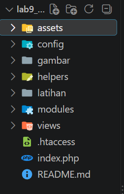
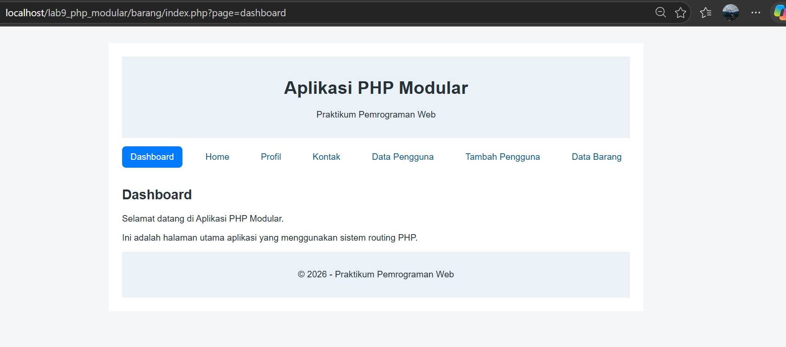
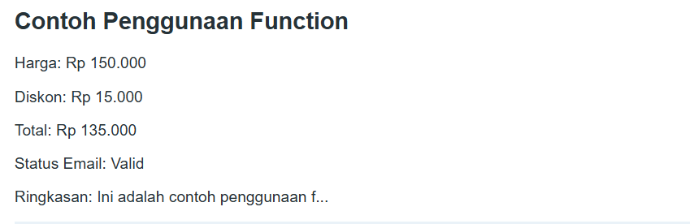
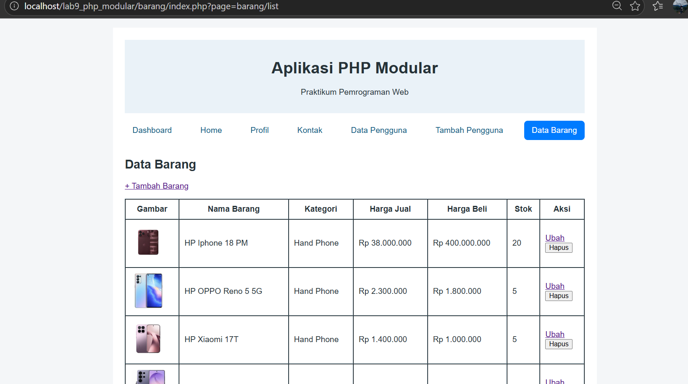

# LAB9WEB — PHP MODULAR

## LAPORAN PRAKTIKUM 9 PEMROGRAMAN WEB

**Modularisasi Program, Function, Template, dan Routing**

---

## Identitas Mahasiswa

| Keterangan | Data |
|---|---|
| Nama | M. Fahmi Abdul Basith |
| NIM | 312510260 |
| Program Studi | Teknik Informatika |
| Universitas | Universitas Pelita Bangsa |
| Mata Kuliah | Pemrograman Web |
| Praktikum | Praktikum 9 - PHP Modular |

---

## 1. Tujuan Praktikum

Praktikum ini bertujuan untuk memahami dan menerapkan konsep **PHP Modular** dengan memisahkan program ke dalam beberapa file berdasarkan tanggung jawabnya.

Tujuan praktikum:

1. Memahami konsep modularisasi program.
2. Memahami penggunaan `include`, `require`, `include_once`, dan `require_once`.
3. Membuat template halaman yang digunakan bersama.
4. Membuat dan menggunakan function PHP dengan parameter dan nilai return.
5. Menyusun struktur direktori aplikasi PHP secara modular.
6. Menerapkan routing berdasarkan parameter URL.
7. Menerapkan validasi dan whitelist pada routing.
8. Membuat halaman 404 untuk route yang tidak tersedia.
9. Mengintegrasikan modularisasi dengan aplikasi database/CRUD dari praktikum sebelumnya.

Modularisasi dilakukan agar program lebih mudah dipahami, digunakan kembali, diuji, dipelihara, dan dikembangkan.

---

# 2. Kebutuhan Perangkat

Perangkat yang digunakan:

- Laptop/PC
- XAMPP
- Apache
- PHP
- MySQL/MariaDB
- Visual Studio Code
- Web Browser
- Git
- GitHub

Project dijalankan menggunakan web server lokal.

---

# 3. Cara Menjalankan Aplikasi

## 3.1 Menempatkan Project

Salin folder:

```text
lab9_php_modular
```

ke folder `htdocs` XAMPP:

```text
C:\xampp\htdocs\
```

Sehingga menjadi:

```text
C:\xampp\htdocs\lab9_php_modular\
```

## 3.2 Menjalankan XAMPP

Buka XAMPP dan aktifkan:

```text
Apache
MySQL
```

## 3.3 Menyiapkan Database

Buka:

```text
http://localhost/phpmyadmin
```

Kemudian siapkan database sesuai konfigurasi pada:

```text
config/database.php
```

Pastikan database dan tabel yang digunakan oleh aplikasi CRUD sudah tersedia.

## 3.4 Menjalankan Project

Buka browser dan akses:

```text
http://localhost/lab9_php_modular/
```

---

# 4. Struktur Direktori Project

Struktur project hasil praktikum:

```text
lab9_php_modular/
│
├── .htaccess
├── index.php
│
├── assets/
│   ├── css/
│   └── js/
│
├── config/
│   └── database.php
│
├── gambar/
│   ├── 6b03ed74cf101_Apple-iPhone-18-Pro-2up-Geo-260909_inline.jpg.large.jpg
│   ├── 6b03eeb4d49de_oppo_oppo_reno_5_5g_garansi_resmi_full01_dd6x7swb.webp
│   ├── 6b03eed11716a_vxiaomi.jpg
│   ├── 6b03eef8bbcb9_samsung.jpg
│   └── 6b03ef485a12f_ip_18.jpg
│
├── helpers/
│   └── functions.php
│
├── latihan/
│   ├── footer.php
│   ├── function-diskon.php
│   ├── function-parameter.php
│   ├── function-return.php
│   ├── function.php
│   ├── halaman1.php
│   ├── halaman2.php
│   ├── header.php
│   ├── helpers.php
│   ├── index.php
│   ├── pesan.php
│   ├── uji-include.php
│   └── uji-require.php
│
├── modules/
│   ├── auth/
│   │   ├── login.php
│   │   └── logout.php
│   │
│   ├── barang/
│   │   ├── add.php
│   │   ├── delete.php
│   │   ├── edit.php
│   │   └── list.php
│   │
│   └── user/
│       ├── add.php
│       ├── delete.php
│       ├── edit.php
│       └── list.php
│
├── views/
│   ├── 404.php
│   ├── dashboard.php
│   ├── footer.php
│   ├── header.php
│   ├── home.php
│   ├── kontak.php
│   └── profil.php
│
└── screenshots/
    ├── 01-struktur-direktori.png
    ├── 02-hasil-template.png
    ├── 03-hasil-function.png
    ├── 04-hasil-routing.png
    └── 05-hasil-crud.png
```

Struktur tersebut mengikuti konsep modularisasi pada modul, yaitu memisahkan konfigurasi, tampilan, helper, modul fitur, dan aset berdasarkan tanggung jawab masing-masing.

---

# 5. Penjelasan Struktur Direktori

## `index.php`

Merupakan titik masuk utama aplikasi dan digunakan sebagai router.

Parameter `page` menentukan halaman atau modul yang akan dijalankan.

Contoh:

```text
index.php?page=user/list
```

---

## `config/`

Digunakan untuk menyimpan konfigurasi aplikasi, termasuk koneksi database.

```text
config/database.php
```

Koneksi database dikelola pada satu file agar tidak perlu ditulis berulang pada setiap halaman.

---

## `views/`

Berisi komponen tampilan yang digunakan bersama:

```text
views/
├── header.php
├── footer.php
├── dashboard.php
├── home.php
├── profil.php
├── kontak.php
└── 404.php
```

`header.php` dan `footer.php` digunakan sebagai template bersama.

---

## `helpers/`

Berisi function umum yang dapat digunakan oleh beberapa bagian aplikasi.

```text
helpers/functions.php
```

---

## `modules/`

Berisi fitur aplikasi yang dikelompokkan berdasarkan fungsi.

```text
modules/
├── auth/
├── barang/
└── user/
```

### Modul User

```text
modules/user/
├── list.php
├── add.php
├── edit.php
└── delete.php
```

### Modul Barang

```text
modules/barang/
├── list.php
├── add.php
├── edit.php
└── delete.php
```

### Modul Auth

```text
modules/auth/
├── login.php
└── logout.php
```

---

## `assets/`

Digunakan untuk menyimpan file statis seperti CSS dan JavaScript.

---

## `gambar/`

Digunakan untuk menyimpan gambar yang digunakan pada aplikasi.


---

# 6. Latihan Include dan Require

Pada folder `latihan` terdapat latihan penggunaan:

- `include`
- `require`
- `include_once`
- `require_once`

Contoh penggunaan:

```php
<?php

echo "Sebelum pemanggilan<br>";

include __DIR__ . '/pesan.php';

echo "Sesudah pemanggilan<br>";

?>
```

Sedangkan `require`:

```php
<?php

echo "Sebelum pemanggilan<br>";

require __DIR__ . '/pesan.php';

echo "Sesudah pemanggilan<br>";

?>
```

Perbedaan utama:

- `include` menghasilkan peringatan apabila file tidak ditemukan dan eksekusi umumnya dapat berlanjut.
- `require` menghasilkan error fatal apabila file tidak ditemukan.
- `include_once` mencegah file dimuat lebih dari satu kali.
- `require_once` mencegah file wajib dimuat lebih dari satu kali.

`__DIR__` digunakan untuk membantu menentukan lokasi file berdasarkan direktori file yang sedang dijalankan.

---

# 7. Function PHP

Latihan function terdapat pada folder:

```text
latihan/
├── function.php
├── function-parameter.php
├── function-return.php
└── function-diskon.php
```

## Function Tanpa Parameter

```php
function tampilkanSalam()
{
    echo "Selamat belajar PHP modular!";
}

tampilkanSalam();
```

## Function dengan Parameter

```php
function sapaPengguna($nama)
{
    echo "Halo, " .
        htmlspecialchars(
            $nama,
            ENT_QUOTES,
            'UTF-8'
        );
}

sapaPengguna("Rina");
```

## Function dengan Return

```php
function hitungLuasPersegiPanjang(
    $panjang,
    $lebar
) {
    return $panjang * $lebar;
}

$luas =
    hitungLuasPersegiPanjang(8, 5);

echo "Luas: " . $luas;
```

## Function dengan Type Declaration

```php
function hitungDiskon(
    float $harga,
    float $persen = 10
): float {

    return $harga *
        ($persen / 100);
}

echo hitungDiskon(200000);
```

Parameter merupakan variabel yang didefinisikan pada deklarasi function, sedangkan argumen adalah nilai yang diberikan saat function dipanggil. `return` digunakan untuk mengembalikan nilai dari function.

---

# 8. Helper Function

File helper:

```text
helpers/functions.php
```

digunakan untuk menyimpan function yang dapat digunakan kembali.

Function yang digunakan antara lain:

```text
formatRupiah()
hitungDiskon()
validasiEmail()
ringkasTeks()
```

Contoh:

```php
function formatRupiah(float $angka): string
{
    return 'Rp ' .
        number_format(
            $angka,
            0,
            ',',
            '.'
        );
}

function e(string $nilai): string
{
    return htmlspecialchars(
        $nilai,
        ENT_QUOTES,
        'UTF-8'
    );
}
```

Helper digunakan untuk mengurangi pengulangan kode dan memusatkan function umum pada satu file. Modul meminta minimal empat function pada helper dan digunakan kembali pada halaman aplikasi.

---

# 9. Template

Template digunakan untuk membuat bagian tampilan yang digunakan bersama oleh beberapa halaman.

File template:

```text
views/header.php
views/footer.php
```

`header.php` digunakan untuk bagian awal halaman, judul, dan navigasi.

`footer.php` digunakan untuk bagian penutup halaman.

Dengan template, halaman Home, Profil, Kontak, dan halaman lainnya dapat menggunakan layout yang sama tanpa menyalin kode header dan footer.

Contoh pemanggilan:

```php
<?php require_once __DIR__ . '/header.php'; ?>

<section class="content">
    <h2>Halaman Home</h2>
    <p>Ini adalah konten halaman.</p>
</section>

<?php require_once __DIR__ . '/footer.php'; ?>
```

---

# 10. Routing

Routing digunakan untuk menentukan halaman yang dijalankan berdasarkan parameter URL.

Pola URL:

```text
index.php?page=nama-route
```

Contoh:

```text
index.php?page=user/list
```

Router menggunakan whitelist untuk menentukan route yang diperbolehkan.

Contoh:

```php
$routes = [
    'dashboard' =>
        __DIR__ .
        '/views/dashboard.php',

    'user/list' =>
        __DIR__ .
        '/modules/user/list.php',

    'user/add' =>
        __DIR__ .
        '/modules/user/add.php',

    'user/edit' =>
        __DIR__ .
        '/modules/user/edit.php',
];
```

Kemudian parameter diperiksa:

```php
$page = $_GET['page'] ?? 'dashboard';

if (
    !is_string($page)
    ||
    !array_key_exists($page, $routes)
) {

    http_response_code(404);

    $contentFile =
        __DIR__ .
        '/views/404.php';

} else {

    $contentFile =
        $routes[$page];
}
```

Setelah route ditentukan:

```php
require_once
    __DIR__ .
    '/views/header.php';

require $contentFile;

require_once
    __DIR__ .
    '/views/footer.php';
```

Penggunaan whitelist mencegah input URL langsung digunakan sebagai path file.

---

# 11. Daftar Route

| Route | File |
|---|---|
| `dashboard` | `views/dashboard.php` |
| `home` | `views/home.php` |
| `profil` | `views/profil.php` |
| `kontak` | `views/kontak.php` |
| `user/list` | `modules/user/list.php` |
| `user/add` | `modules/user/add.php` |
| `user/edit` | `modules/user/edit.php` |
| `user/delete` | `modules/user/delete.php` |
| `barang/list` | `modules/barang/list.php` |
| `barang/add` | `modules/barang/add.php` |
| `barang/edit` | `modules/barang/edit.php` |
| `barang/delete` | `modules/barang/delete.php` |
| `auth/login` | `modules/auth/login.php` |
| `auth/logout` | `modules/auth/logout.php` |

---

# 12. Halaman 404

Apabila route tidak terdapat pada whitelist, aplikasi akan menampilkan halaman 404.

Contoh:

```text
index.php?page=admin/rahasia
```

Hasil:

```text
404 - Halaman tidak ditemukan
```

File:

```text
views/404.php
```

Modul mengharuskan route yang tidak dikenal menghasilkan halaman 404.

---

# 13. Modul User

Folder:

```text
modules/user/
```

terdiri dari:

```text
list.php
add.php
edit.php
delete.php
```

Fungsinya:

- `list.php` — menampilkan data user.
- `add.php` — menambahkan data user.
- `edit.php` — mengubah data user.
- `delete.php` — menghapus data user.

Contoh route:

```text
index.php?page=user/list
```

---

# 14. Modul Barang

Folder:

```text
modules/barang/
```

terdiri dari:

```text
list.php
add.php
edit.php
delete.php
```

Fungsinya:

- `list.php` — menampilkan data barang.
- `add.php` — menambahkan data barang.
- `edit.php` — mengubah data barang.
- `delete.php` — menghapus data barang.

---

# 15. Modul Auth

Folder:

```text
modules/auth/
```

berisi:

```text
login.php
logout.php
```

`login.php` digunakan untuk proses login.

`logout.php` digunakan untuk proses logout.

---

# 16. Database

Konfigurasi database diletakkan pada:

```text
config/database.php
```

Dengan demikian koneksi database dikelola pada satu tempat dan dapat digunakan oleh modul lain.

Project dapat menggunakan MySQLi atau PDO sesuai teknologi koneksi yang digunakan pada praktikum sebelumnya. Modul menyebutkan bahwa jika project sebelumnya menggunakan MySQLi, koneksi tersebut dapat dipindahkan ke `config/database.php`.

---

# 17. Integrasi CRUD

Aplikasi CRUD dari praktikum sebelumnya diintegrasikan ke struktur modular.

Struktur:

```text
modules/
├── user/
│   ├── list.php
│   ├── add.php
│   ├── edit.php
│   └── delete.php
│
└── barang/
    ├── list.php
    ├── add.php
    ├── edit.php
    └── delete.php
```

Operasi CRUD:

| Operasi | Fungsi |
|---|---|
| Create | Menambah data |
| Read | Menampilkan data |
| Update | Mengubah data |
| Delete | Menghapus data |

Semua operasi CRUD tetap dapat dijalankan melalui struktur modular dan routing. Modul meminta seluruh halaman menggunakan template bersama dan dapat diakses melalui router.

---

# 18. `.htaccess`

Project memiliki file:

```text
.htaccess
```

yang dapat digunakan untuk menerapkan URL rewrite.

Konfigurasi:

```apache
RewriteEngine On

RewriteCond %{REQUEST_FILENAME} !-f
RewriteCond %{REQUEST_FILENAME} !-d

RewriteRule ^(.+)$ index.php?page=$1 [QSA,L]
```

Dengan aturan tersebut, URL seperti:

```text
/project/user/list
```

dapat diteruskan ke:

```text
/project/index.php?page=user/list
```

Fitur ini membutuhkan `mod_rewrite` dan konfigurasi `AllowOverride` yang sesuai.

---

# 19. Pengujian Praktikum

## 19.1 Pengujian Template

Akses halaman aplikasi melalui browser dan pastikan:

- Header tampil.
- Navigasi tampil.
- Konten halaman tampil.
- Footer tampil.
- Tampilan konsisten antar halaman.

---

## 19.2 Pengujian Function

Function diuji melalui latihan pada folder:

```text
latihan/
```

Pengujian memastikan function:

- Dapat dipanggil.
- Dapat menerima parameter.
- Dapat menghasilkan nilai return.
- Menghasilkan perhitungan yang sesuai.

---

## 19.3 Pengujian Routing

Contoh:

```text
http://localhost/lab9_php_modular/
```

dan:

```text
http://localhost/lab9_php_modular/index.php?page=user/list
```

Pastikan halaman yang sesuai ditampilkan.

---

## 19.4 Pengujian Route Tidak Dikenal

Buka:

```text
http://localhost/lab9_php_modular/index.php?page=admin/rahasia
```

Hasil yang diharapkan:

```text
404 - Halaman tidak ditemukan
```

---

## 19.5 Pengujian CRUD

Pengujian dilakukan pada modul:

```text
User
Barang
```

dengan operasi:

```text
Tambah
Tampilkan
Edit
Hapus
```

Pastikan data yang ditambahkan atau diubah tersimpan pada database dan data yang dihapus tidak lagi tampil pada daftar.

---

# 20. Dokumentasi Screenshot

Screenshot yang dimasukkan ke repository **hanya screenshot hasil/output praktikum**, sehingga tidak perlu memasukkan screenshot potongan kode.

Folder:

```text
screenshots/
```

berisi:

### 1. Hasil Struktur Direktori




Berisi tampilan struktur folder project pada Visual Studio Code.

### 2. Hasil Template



Berisi tampilan halaman aplikasi yang menunjukkan header, navigasi, konten, dan footer sudah berjalan.

### 3. Hasil Function



Berisi tampilan hasil latihan function, misalnya hasil perhitungan atau output function yang telah dibuat.

### 4. Hasil CRUD



Berisi tampilan hasil pengujian CRUD pada aplikasi, terutama hasil data yang berhasil ditampilkan, ditambahkan, diubah, atau dihapus.

Dokumentasi tersebut mencakup bagian yang diwajibkan pada modul: struktur direktori, template, function, routing, dan hasil pengujian CRUD.

---

# 21. Kendala dan Cara Mengatasi

## Kendala 1 — Path File Salah

**Masalah:** file tidak ditemukan ketika menggunakan `include` atau `require`.

**Solusi:** menggunakan `__DIR__` untuk menentukan lokasi file.

```php
require_once
    __DIR__ .
    '/helpers/functions.php';
```

---

## Kendala 2 — Function Sudah Dideklarasikan

**Masalah:** function dimuat lebih dari satu kali.

**Solusi:** menggunakan:

```php
require_once
```

atau:

```php
include_once
```

---

## Kendala 3 — Route Menghasilkan 404

**Masalah:** route tidak ditemukan.

**Solusi:** memeriksa nama route pada whitelist dan memastikan penulisan parameter `page` sesuai.

---

## Kendala 4 — CSS Tidak Tampil

**Masalah:** CSS tidak ditemukan ketika halaman diakses melalui route tertentu.

**Solusi:** memeriksa path:

```text
assets/css/style.css
```

dan memastikan path aset sesuai.

---

## Kendala 5 — URL Rewrite Tidak Berfungsi

**Masalah:** URL sederhana tidak dapat digunakan.

**Solusi:**

- Memastikan `mod_rewrite` aktif.
- Memastikan `.htaccess` berada pada folder project.
- Memastikan Apache mengizinkan penggunaan `.htaccess`.
- Melakukan restart Apache.

Modul juga mencantumkan masalah path file, function yang terdeklarasi berulang, CSS, route 404, dan URL rewrite sebagai permasalahan umum.

---

# 22. Hasil Praktikum

Hasil praktikum menunjukkan bahwa aplikasi berhasil menerapkan konsep PHP Modular, meliputi:

- Modularisasi program.
- `include`.
- `require`.
- `include_once`.
- `require_once`.
- Function dengan parameter.
- Function dengan return.
- Type declaration.
- Helper function.
- Template header dan footer.
- Struktur direktori modular.
- Routing dengan parameter URL.
- Whitelist routing.
- Halaman 404.
- Modul User.
- Modul Barang.
- Modul Auth.
- Konfigurasi database.
- Integrasi CRUD.
- URL rewrite menggunakan `.htaccess`.

CRUD tetap dapat digunakan setelah aplikasi dipisahkan ke dalam struktur modular. Hal ini sesuai dengan tujuan praktikum untuk mengintegrasikan modularisasi dan routing dengan aplikasi database dari praktikum sebelumnya.

---

# 23. Kesimpulan

Praktikum PHP Modular memberikan pemahaman mengenai cara membagi aplikasi menjadi beberapa bagian berdasarkan fungsi dan tanggung jawabnya.

Penggunaan `include`, `require`, `include_once`, dan `require_once` membantu mengelola pemanggilan file. Function dan helper mengurangi pengulangan kode. Template membuat header, navigasi, dan footer dapat digunakan bersama oleh beberapa halaman.

Routing menggunakan parameter URL membuat pemanggilan halaman menjadi lebih terstruktur. Whitelist memastikan hanya route yang telah ditentukan yang dapat dijalankan, sedangkan halaman 404 digunakan untuk menangani route yang tidak tersedia.

Pada project ini, konsep modularisasi juga diterapkan pada aplikasi CRUD melalui modul User dan Barang, serta modul Auth untuk proses login dan logout. Konfigurasi database dipisahkan ke dalam folder `config`, sedangkan tampilan ditempatkan pada folder `views`.

Dengan struktur tersebut, aplikasi menjadi lebih terorganisir, mudah dipahami, dipelihara, diuji, dan dikembangkan.

---